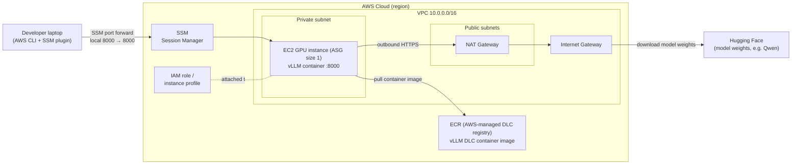

# vLLM on EC2 (private, SSM access)

> **Disclaimer**: This sample code is provided for educational/demonstration purposes and is NOT intended for production use without additional security hardening. See [SECURITY.md](SECURITY.md) for production recommendations.

Runs a vLLM inference server on a single GPU EC2 instance in a **private subnet**.
You reach it through an **SSM port-forwarding tunnel**, so nothing is exposed to
the internet.

> **Optional:** If you later need a shared or public HTTP endpoint, you can front
> the instance with an Application Load Balancer (HTTPS listener + ACM
> certificate, ingress restricted to known CIDRs). This is not included here and
> would expose the API, so add authentication (e.g. vLLM `--api-key`) before
> doing so.

Default model: `Qwen/Qwen2.5-0.5B-Instruct` on a `g5.xlarge`.

> All Terraform lives in [`terraform-vllm/`](terraform-vllm/). Run the commands
> below from inside that directory.

## Context and objective

**Context:** Serving an LLM often means exposing an inference API, which adds
network attack surface. This sample shows how to serve an LLM through vLLM on
AWS without any public endpoint. The Terraform provisions a single GPU EC2
instance (managed by
an Auto Scaling Group of size 1) in a **private subnet**, using an AWS Deep
Learning AMI. On boot, the instance pulls the vLLM Deep Learning Container image
from ECR and serves the OpenAI-compatible API on port 8000. Networking (VPC,
subnets, NAT gateway) is created by default or can reuse existing resources, and
access is granted through AWS Systems Manager (SSM) rather than SSH.

**Objective:** Deploy a private, self-contained vLLM inference server that is
**not reachable from the internet**. There is no load balancer and no public IP;
you reach the API by opening an SSM port-forwarding tunnel (local 8000 →
instance 8000). The instance security group has no inbound rules, and access
relies on IAM plus SSM Session Manager, keeping the inference endpoint off the
public network.

## Architecture



## Prerequisites

- AWS credentials configured (`aws configure`) with rights to create EC2/VPC/IAM/ASG.
- [Terraform](https://developer.hashicorp.com/terraform/install) installed.
- AWS Session Manager plugin (for the tunnel):
  `brew install --cask session-manager-plugin`
- Copy `terraform.tfvars.example` to `terraform.tfvars` and set your values
  (`region`, and optionally existing `vpc_id` / `private_subnet_id`).
  The `region` in `terraform.tfvars` wins over the variable default — make sure
  any existing VPC/subnet IDs live in that region.

## Deploy

```bash
cd terraform-vllm
terraform init
terraform plan
terraform apply   # type "yes" when prompted
```

## How long to wait

After `apply` finishes, the instance still needs **~8–12 minutes** to:
boot → pull the vLLM container image (the slow part, several GB) →
download the model → load it onto the GPU.

Don't guess — watch for readiness (see below).

## Test it

1. Get the instance ID:
   ```bash
   aws autoscaling describe-auto-scaling-instances --region us-west-2 \
     --query "AutoScalingInstances[?AutoScalingGroupName=='vllm-asg'].InstanceId" \
     --output text
   ```

2. Start the tunnel (local 8000 → instance 8000) and leave it running:
   ```bash
   aws ssm start-session --target <instance-id> --region us-west-2 \
     --document-name AWS-StartPortForwardingSession \
     --parameters '{"portNumber":["8000"],"localPortNumber":["8000"]}'
   ```

3. In another terminal, wait until health returns `200`:
   ```bash
   curl -s -o /dev/null -w "%{http_code}\n" http://localhost:8000/health
   ```

4. Send a chat request:
   ```bash
   curl http://localhost:8000/v1/chat/completions \
     -H "Content-Type: application/json" \
     -d '{"model": "Qwen/Qwen2.5-0.5B-Instruct", "messages": [{"role": "user", "content": "Hello"}], "max_tokens": 100}'
   ```

`terraform output vllm_access` reprints these steps anytime.

## Troubleshooting

- **"Connection to destination port failed"** in the tunnel
  vLLM isn't listening on 8000 yet. It's still starting — wait and retry.
  The tunnel auto-connects once vLLM binds to the port.

- **`/health` returns `000` or connection refused**
  Same cause: model still loading. Give it a few more minutes.

- **Check progress / logs** — SSM into the box:
  ```bash
  aws ssm start-session --target <instance-id> --region us-west-2
  ```
  then:
  ```bash
  sudo tail -n 50 /var/log/vllm-setup.log   # look for "=== vLLM Setup Complete ==="
  sudo docker ps                            # vllm-server should be "Up"
  sudo docker logs --tail 50 vllm-server    # look for "Uvicorn running on http://0.0.0.0:8000"
  ```

- **Container exited** (`sudo docker ps -a` shows Exited)
  Read the reason: `sudo docker logs --tail 50 vllm-server`. Common causes are
  GPU out-of-memory (lower `gpu_memory_utilization` or `max_model_len`) or a
  model download failure.

- **`model` not found error from the API**
  The `"model"` in your request must exactly match `model_name` in `terraform.tfvars`.

## Tear down

GPU instances are not cheap — destroy when done:

```bash
cd terraform-vllm
terraform destroy
```
